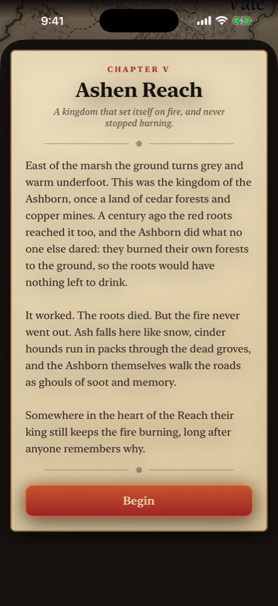
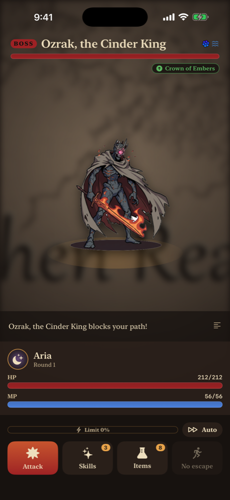
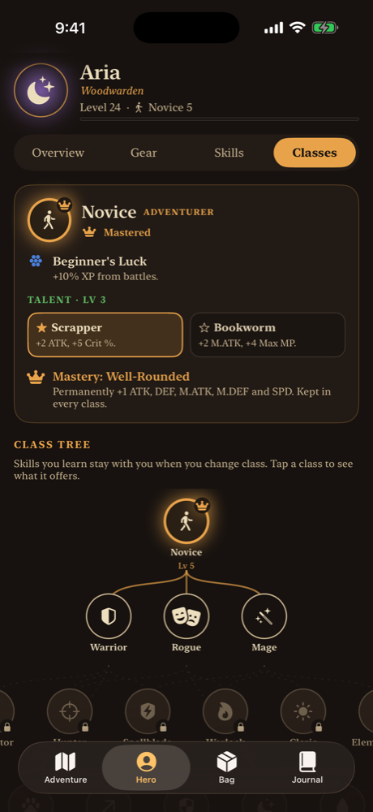
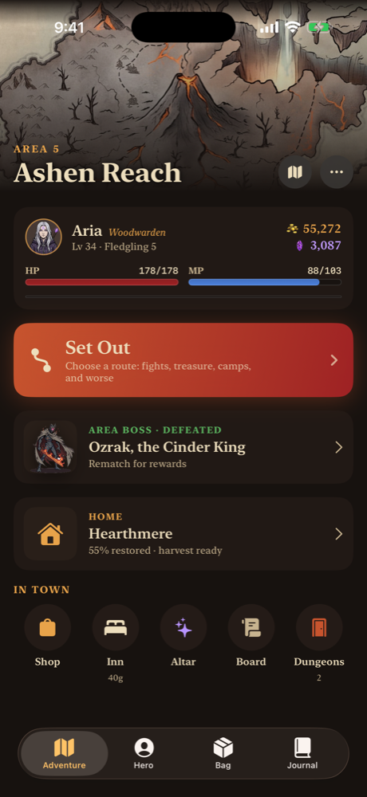
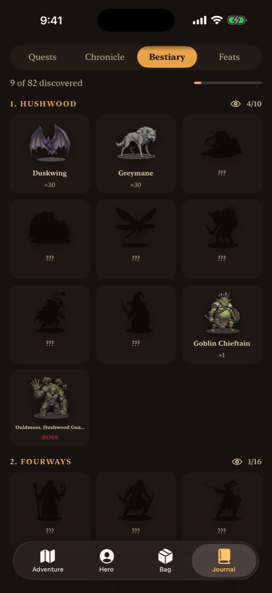
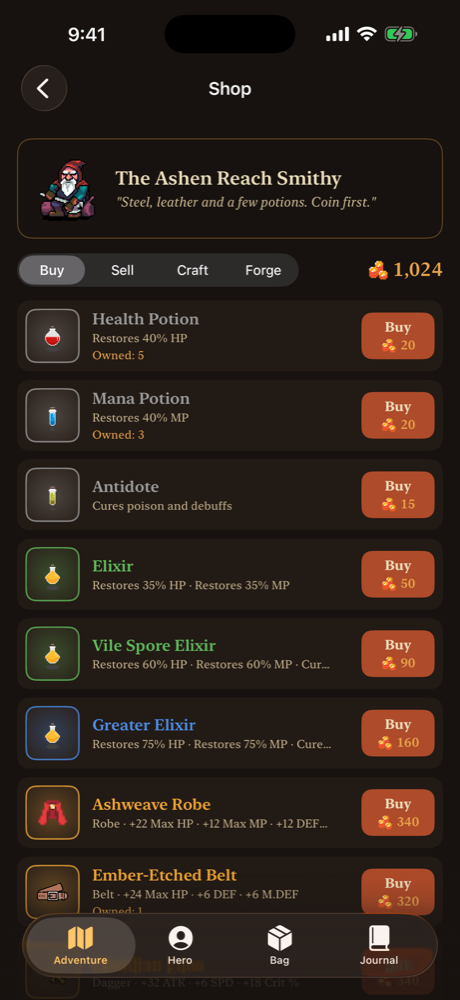

# Vantheria

A dark-fantasy, turn-based RPG for iPhone, built natively in SwiftUI. It started as an RPG I ran on my Discord server, and I rebuilt it from the ground up as a full mobile game with a seven-chapter story, tactical
battles and a deterministic, fully tested game engine.

**Swift · SwiftUI · Swift Testing · AVFoundation · iCloud · XcodeGen · no third-party dependencies**

### ▶ [Play the beta on TestFlight](https://testflight.apple.com/join/w8hMG9HQ)

Works on iPhone and iPad with Apple's free TestFlight app. If the beta is full or the build has expired, email
me at [vaniilla9@icloud.com](mailto:vaniilla9@icloud.com) for access.

  
  
  

  
  
  

> The source code is in a private repository. I'm happy to walk through it or share access for interviews.
> Contact me through my GitHub profile.

## The game

- Seven areas, fourteen dungeons and a hidden final chapter, with choices that lead to one of three endings.
- Tactical battles: see what the enemy plans next, chain elements into combos, break its guard and unleash
  your class finisher.
- 21 classes across five tiers, including subclasses and secret classes.
- Relics, rolled loot, gear sets, a forge and crafting from monster parts.
- A home village to rebuild, companions with bond scenes, and an endless roguelite tower with a weekly challenge.
- Branching d20 adventures, New Game+, achievements, and three difficulty levels.
- Fully offline, with saves synced through iCloud.

## Technical highlights

- **From chat bot to native game:** ~17,600 lines of Swift written from scratch, redesigning the original
  bot game's systems, such as buffs that permanently changed base stats in the original.
- **Pure, deterministic engine:** game logic has no UI dependencies, and all randomness goes through an
  injectable source, so any battle or playthrough can be replayed exactly. The UI animates a stream of battle
  events the engine emits.
- **Data-driven content:** areas, enemies, items, skills, classes and quests are JSON, and every
  cross-reference is validated at launch.
- **Balance by simulation:** a command-line simulator compiles the real engine and has bot players (optimal,
  typical, casual) play through the game across many random seeds. It reports pacing, win rates and damage
  taken per enemy, so balance changes are measured instead of guessed.
- **129 automated tests** in Swift Testing, covering formulas, the battle engine, data integrity, progression,
  localization and full-area playthroughs.
- **Reproducible project:** the Xcode project is generated from a spec file with XcodeGen, so the build is
  defined in code.

## Status

Feature-complete and in public beta on [TestFlight](https://testflight.apple.com/join/w8hMG9HQ), with an App Store
release planned.

---

© 2026 vaniilla9. All rights reserved.
